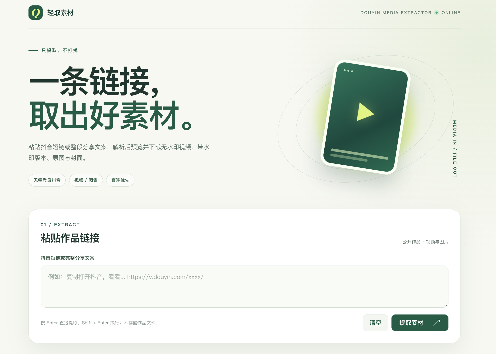

# 轻取素材

一个轻量的抖音公开作品素材提取网页。粘贴短链、作品链接或整段分享文案，即可预览并下载视频、图集原图与封面。

在线使用：[douyin.earlxu.online](https://douyin.earlxu.online)



## 功能

- 支持视频、图集、实况图文 LivePhoto、封面和带水印视频。
- 优先从抖音 CDN 直连下载，失败时可切换服务器备用下载。
- 视频按平台实际提供的最高分辨率和码率选择。
- 图集优先选择 `origin_image` 原图。
- 无需登录抖音，不使用账号 Cookie。
- 不调用 AI 或转写服务。

## 本地运行

需要 Python 3.11+：

```bash
python3 -m venv .venv
.venv/bin/python -m pip install -r requirements.txt
.venv/bin/python -m uvicorn app:app --host 127.0.0.1 --port 8765
```

浏览器打开 <http://127.0.0.1:8765>。输入框按 `Enter` 直接提取，`Shift + Enter` 换行。

## 测试

```bash
.venv/bin/python -m unittest discover -s tests -v
```

## 部署

项目支持原生 Python + systemd 部署，生产环境建议通过 NPM 提供 HTTPS 反向代理。详细配置和回滚方式见 [deploy/README.md](deploy/README.md)。

## 说明

- 仅解析公开且平台允许访问的作品，不绕过私密、下架或权限限制。
- 游客标识 `ttwid` 只用于匿名访问，不读取浏览器登录状态。
- 实况图文通过匿名访客 `UIFID`、`ttwid` 和抖音 WebSign 请求公开作品详情；如果平台拒绝匿名访客详情请求，会自动降级为所有可获得的静态原图。
- “无水印”指平台提供的无水印播放源，不代表作者上传前的原始母文件。
- 平台没有提供的画质或原图无法凭空生成。
